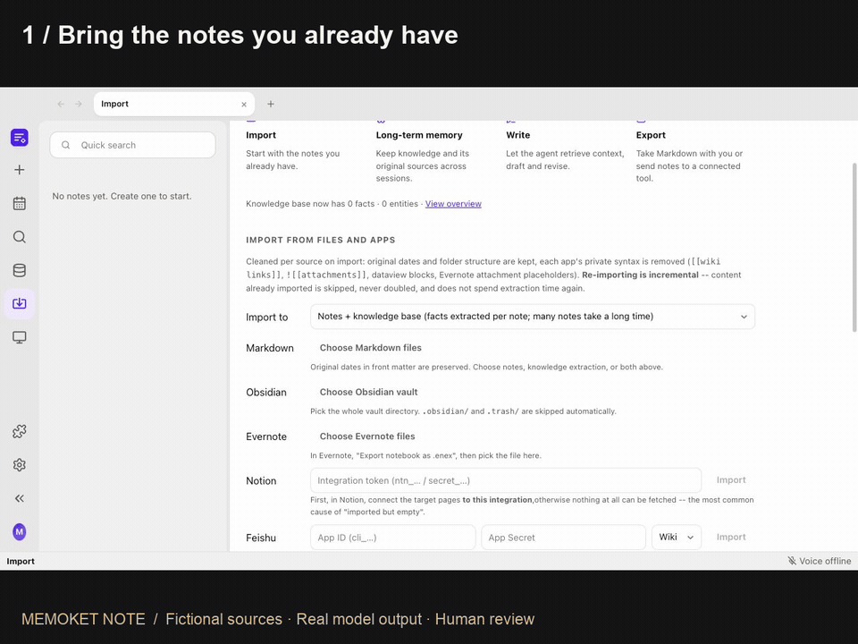
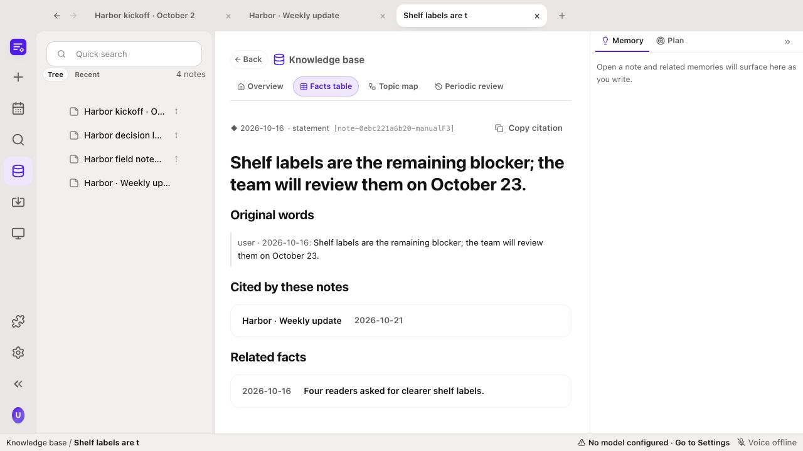

<p align="center">
  <a href="https://memoket.ai"></a>
</p>

<p align="center"><strong>MEMOKET NOTE</strong> &nbsp; / &nbsp; Agent-native writing workspace</p>

<h1 align="center">A writing agent that<br>remembers your work.</h1>

<p align="center">
  Bring your notes. Keep the evidence. Write your next draft.<br>
  Take it back to the tools you already use.
</p>

<p align="center">
  <a href="#watch-the-workflow"><strong>Watch the 80-second demo</strong></a> &nbsp; · &nbsp;
  <a href="#development-setup"><strong>Run locally</strong></a> &nbsp; · &nbsp;
  <a href="https://github.com/memoket/memoket-kite">Explore KITE</a>
</p>

<p align="center">
  <a href="docs/media/agent-native-writing-workspace.mp4"></a>
  <br><sub>A real draft, with its memory and evidence in view. All demo material is fictional.</sub>
</p>

<p align="center">
  <a href="#bring-your-notes-keep-your-workflow">Connections</a> &nbsp; · &nbsp;
  <a href="#memory-that-outlasts-the-document">Long-term memory</a> &nbsp; · &nbsp;
  <a href="#why-agent-native">The writing agent</a> &nbsp; · &nbsp;
  <a href="docs/architecture.md">Architecture</a> &nbsp; · &nbsp;
  <a href="CONTRIBUTING.md">Contributing</a>
</p>

---

## Your next draft starts with what you already know

Yesterday's notes hold the decisions, sources and details you need today.
NOTE brings them into a persistent memory library, then gives a writing agent
the tools to turn that history into a draft you can inspect, revise and export.

<table>
  <tr>
    <td width="50%" valign="top"><h3>01 &nbsp; Import</h3><p>Bring Markdown, an Obsidian vault, Notion or Apple Notes. Start with the material you already have.</p></td>
    <td width="50%" valign="top"><h3>02 &nbsp; Memory</h3><p>KITE keeps facts, dates and original evidence in a local library that lasts across documents and sessions.</p></td>
  </tr>
  <tr>
    <td valign="top"><h3>03 &nbsp; Write</h3><p>Set the goal. Let the agent retrieve, draft, check and revise. Review its changes and sources.</p></td>
    <td valign="top"><h3>04 &nbsp; Export</h3><p>Download Markdown or send the draft to a local vault or configured destination. Keep your workflow.</p></td>
  </tr>
</table>

## Watch the workflow

**Three notes → lasting memory → a reviewed weekly update → Markdown / Obsidian.**

[](docs/media/agent-native-writing-workspace.mp4)

<p align="center">
  <a href="docs/media/agent-native-writing-workspace.mp4"><strong>Play the full demo · 80 seconds</strong></a> &nbsp; · &nbsp;
  <a href="docs/media/agent-native-writing-workspace.en.vtt">Captions</a> &nbsp; · &nbsp;
  <a href="docs/media/agent-native-writing-workspace.md">Transcript</a> &nbsp; · &nbsp;
  <a href="docs/workspace-tour.md">Try the example</a>
</p>

The [Maple pilot example](examples/maple-pilot.md) uses three invented notes.
**14 extracted facts survive a backend restart.** GPT-4.1 writes a draft citing
10 saved facts. A reviewer removes a repeated title and corrects an unsupported
timing claim, then exports the reviewed body to Markdown and an Obsidian vault.

<details>
<summary><strong>About the recording</strong></summary>

This is an edited capture of actual application interactions and live model
output, with sampled screen frames, shortened waits and synthetic English
narration. Source material is entirely fictional. The recording demonstrates
Markdown import and local export. Notion and Apple Notes appear as available
connections without accessing personal accounts. Model output still needs review.

</details>

## Memory that outlasts the document

**Close the note. Come back later. The evidence is still there.**

Local KITE memory persists across notes and application sessions. Retrieval
follows the paragraph at your cursor; you can inspect a fact's date and original
words, quote it with a source link, or add it to the task's Materials.



<p align="center"><sub>Open a remembered fact to see what was actually said, when, and where it is used.</sub></p>

The knowledge base also lets you browse facts, entities, source records and a
timeline. Remembering a fact does not make it current or correct: the evidence
stays visible so you can check it.

## Why agent-native?

**The task, tools and review loop live inside the document workspace.**

The agent works on a selected passage, block, note or multi-note plan. It can
retrieve memory, use selected Materials, write and revise, then run checks before
choosing its next step. You stay in control through visible progress, edit review,
snapshots and history.

<p align="center"><strong>Prepare evidence &nbsp; → &nbsp; Draft &nbsp; → &nbsp; Check &nbsp; → &nbsp; Revise &nbsp; → &nbsp; Review</strong></p>

A direct Continue action handles a small passage. Smart Continue runs an
iterative workflow, with an option to pause after each round so you can accept
or revert changes.

<details>
<summary><strong>Inside the writing agent harness</strong></summary>

The **workspace** is the writing application. **KITE** is its memory engine.
The **writing agent harness** coordinates task state, tools, rounds, checks,
stopping conditions and recovery.

| The agent needs | The harness provides |
|---|---|
| A bounded task | Scope, goal, audience and done criteria |
| Relevant context | KITE retrieval, source links and selected Materials |
| A way to act | Retrieval, writing, revision and supported generated-block tools |
| Feedback | Code checks for constraints and configured model judging |
| A next step | Policy to revise, continue, pause or stop within limits |
| Human control | Run progress, edit review, snapshots and history |

The shared loop supports note and section writing as well as supported chart,
table and analysis blocks. It can keep an earlier best round when a later round
regresses. Automated checks support review; they do not prove factual accuracy.
See the [implementation architecture](docs/architecture.md).

</details>

<details>
<summary><strong>104 templates. More than an outline.</strong></summary>

Templates across 12 categories set sourcing, writing, checking and finish rules.
A weekly report and a technical design document need different evidence and
completion criteria. You can also define a custom task for one note.


</details>

## Bring your notes. Keep your workflow.

**Markdown · Obsidian · Notion · Apple Notes · Feishu · Evernote**

Import existing material, write with its memory, then take the reviewed draft
back to your tools. Downloading Markdown needs no account. Connections use files
and supported account integrations.


<p align="center"><sub>Export the current draft as Markdown, to a local Obsidian vault, or to a configured Notion or Feishu destination.</sub></p>

<details>
<summary><strong>See every import and export option</strong></summary>

| Your existing tool or material| Bring it into NOTE | Take work out of NOTE |
|---|---|---|
| Markdown / Obsidian | Import Markdown files or a vault; retain the folder structure and clean app-specific syntax | Export Markdown or write into a local vault |
| Notion | Import pages accessible to your integration | Write notes as child pages under a selected parent |
| Feishu | Import supported documents, Drive or Wiki content available to your app | Write documents into a selected folder |
| Evernote | Import exported `.enex` notebooks | Export the resulting notes as Markdown |
| Apple Notes on macOS | Import through the local Notes app | Export Markdown for further use |
| PDF, DOCX and plain text | Batch import source documents into the knowledge base | Use the recalled evidence in your drafts |
| Recordings | Transcribe with a configured local or hosted service, then import | Work from the transcript and extracted knowledge |
| A web page | Clip its text into the current note's Materials | Use the selected material during writing |

</details>

Notion and Feishu adapters still need real-account end-to-end validation.
Apple Notes import uses the local macOS Notes app. These are explicit imports and
exports; universal live synchronization and editor extensions are not included.
See [connection setup and limits](docs/connections.md).

---

## Development setup

Use Python 3.11 and Node.js 22.12 or later. The browser edition needs a
current browser, including Safari 17.4 or later. From the repository root:

```sh
python3 -m venv backend/.venv
backend/.venv/bin/python -m pip install --upgrade pip setuptools -c backend/constraints.txt
backend/.venv/bin/python -m pip install -r backend/requirements.txt -r backend/requirements-dev.txt -c backend/constraints.txt
cp .env.example backend/.env
```

Start the backend:

```sh
cd backend
.venv/bin/python -m uvicorn app.main:app --reload --host 127.0.0.1 --port 8000
```

In another terminal, start the frontend:

```sh
cd frontend
npm ci
npm run dev
```

Open `http://localhost:5173`. Vite proxies `/api` to the backend. The API reference
is at `http://127.0.0.1:8000/docs`; `/api/health` reports backend and service status.

In Settings, select a writing provider and model. Hosted providers need your own
credentials. Local providers need a running OpenAI-compatible server. Environment
variables provide deployment defaults; settings saved in the application take
precedence. An optional judge model can be configured separately.

<details>
<summary><strong>Desktop development and packaging</strong></summary>

Keep the Vite development server running, then start Electron:

```sh
cd desktop
npm ci
npm run dev
```

To package, install PyInstaller in the backend virtual environment, then build:

```sh
backend/.venv/bin/python -m pip install pyinstaller -c backend/constraints.txt
cd desktop
npm run dist
```

Packages are written to `desktop/out/`. Signing credentials are specific to the
maintainer's environment; contributors can override electron-builder signing
configuration for their own builds. A package includes the backend and frontend.
User data is stored outside the application bundle.

</details>

<details>
<summary><strong>Architecture and implementation</strong></summary>

A React and CodeMirror editor runs over a FastAPI backend, with KITE for local
memory and an Electron desktop shell. The [architecture guide](docs/architecture.md)
explains the modules, writing tools and harness loop. The running backend exposes
request schemas at `/docs`.

Interactive writing paths use deterministic retrieval. Model-based planning is
available on the explicit knowledge question path. Writing workflows share a loop
and express their differences through mode configuration and checks.

Design references: [architecture](docs/architecture.md),
[UI conventions](docs/UI_SPEC.md), and [shared cases](shared/README.md).

</details>

<details>
<summary><strong>Validation and test commands</strong></summary>

See [validation notes](docs/validation.md) for results, platforms and remaining manual checks.
Automatic CI is not enabled in this initial publication; a
[GitHub Actions workflow template](docs/ci-workflow.yml.example) is included.

```sh
cd backend
PYTHONPATH=. .venv/bin/python -m pytest -q

cd ../frontend
npm test
npm run build

cd ../desktop
npm run build
```

Automated tests use stubs instead of live model calls. The separately recorded
Maple workflow uses a real configured model. Frontend test commands give
backend subprocesses disposable data directories. Backend fixtures isolate database
writes. The source distribution excludes private corpora, archived research evidence and
screenshot-driving scripts. Test results are not live-model quality benchmarks.

Frontend checks cover types, lint, component/editor behavior and shared
frontend/backend contracts. The source-language audit rejects literal Han characters
outside the dedicated optional translation dictionaries. Model instructions and
default UI text are English; multilingual document content remains supported.

See [CONTRIBUTING.md](CONTRIBUTING.md) for change conventions and
[SECURITY.md](SECURITY.md) for deployment and reporting guidance.

</details>

## A personal project, built on KITE

[KITE](https://github.com/memoket/memoket-kite) is Memoket's separate open-source
memory engine. It stores structured facts with source evidence and supports
inspectable retrieval without an embedding or vector-database stack.

NOTE uses the `memoket-kite` Python package through adapters in
`backend/app/database/kite/`. This repository adds the note editor, material tray,
writing workflows, checks and change-review interface around that memory layer.
KITE remains an independent project with its own repository and Apache-2.0
license; this application's code uses AGPL-3.0-only.

This is a personal project based on KITE. The Memoket name and artwork connect it
to the memory engine's origins and [memoket.ai](https://memoket.ai). They do not
imply that this repository has the commercial product's support commitments.
The local KITE integration does not require a Memoket wearable or subscription.
Production synchronization with Gem or the Memoket App is not included here.

### Data, providers and current scope

The default interface language is English. Notes and settings are stored locally.
AI features send relevant content to the model or transcription service you
configure. Local services can keep content on your machine or network; hosted
services require your own accounts and may incur usage charges.

This is an early personal project for a trusted local environment. Notion and
Feishu integrations need real-account validation. Slide export covers Markdown
slides and PDF. See [SECURITY.md](SECURITY.md) for data flow and deployment limits.

### License and attribution

Licensed under [AGPL-3.0-only](LICENSE). See
[third-party notices](docs/third-party-notices.md) for attribution and dependency
information. Model weights are not included. Provider services have their own
terms and account requirements.

<p align="center">
  <a href="https://memoket.ai">Memoket</a> &nbsp; · &nbsp;
  <a href="https://github.com/memoket/memoket-kite">KITE memory engine</a> &nbsp; · &nbsp;
  <a href="CONTRIBUTING.md">Contribute</a> &nbsp; · &nbsp;
  <a href="SECURITY.md">Security</a>
</p>
