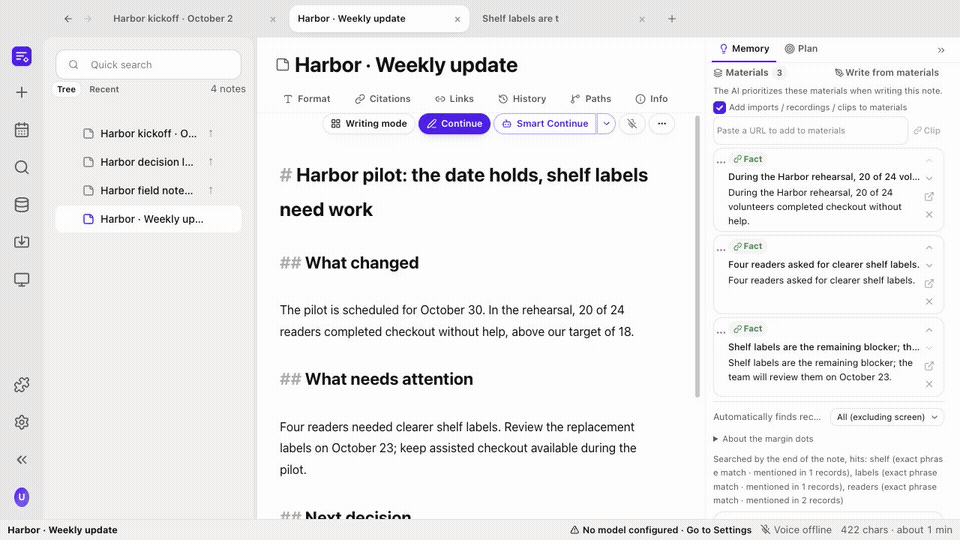
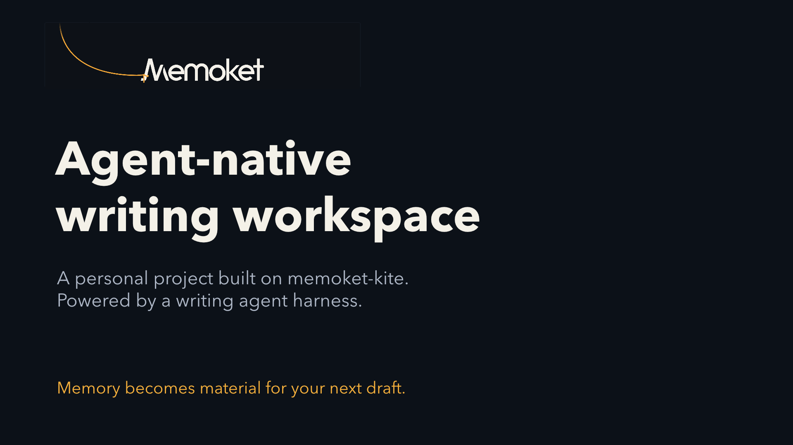

<p align="center">
  <a href="https://memoket.ai"></a>
</p>

# MEMOKET NOTE

**Turn weeks of notes into a draft you can trace back to its sources.**

An **agent-native writing workspace** with long-term memory and reviewable edits.
A personal open-source project built on the
[Memoket KITE memory engine](https://github.com/memoket/memoket-kite).

Meeting notes, research and project decisions accumulate across documents.
Your next report should be able to use that material without making you paste
all the background into another chat. MEMOKET NOTE keeps the draft, its task,
source material and writing agent in one workspace.


[Actual UI tour](docs/media/workspace-ui-tour.mp4) ·
[Try it locally](#development-setup) ·
[Connect your existing tools](#connect-your-existing-writing-tools) ·
[How the agent works](#why-agent-native) ·
[Architecture](docs/architecture.md)

## A report that remembers the work behind it

Imagine a pilot described in three notes written weeks apart: the original goal,
a later decision and the latest field observations. You need a weekly update,
with the current plan, a blocker and what happens next.

1. **Bring in the material.** Import notes, documents or recordings, or add facts
   manually. Keep source evidence attached to what you remember.
2. **Set the writing task.** Choose a template or define the goal, audience and
   completion criteria. The task stays with the note.
3. **Use earlier knowledge.** Retrieve related facts as you write, inspect their
   original words and collect the evidence in the Materials tray.
4. **Write and review.** Continue a passage or start a multi-round workflow.
   Review the changes and their sources before keeping or exporting the draft.

The example below shows **actual application screens**, using invented Harbor
notes and manually entered facts. The tour is an edited sequence of actual screenshots showing navigation, a
source quotation and writing templates. It does not show a live model run.

[](docs/media/workspace-ui-tour.mp4)

[Watch the UI tour](docs/media/workspace-ui-tour.mp4) ·
[English captions](docs/media/workspace-ui-tour.en.vtt) ·
[Follow the walkthrough](docs/workspace-tour.md) ·
[Read the narrated architecture introduction](docs/media/agent-native-writing-workspace.md)

## Where long-term memory appears

Memory persists in the local KITE library across notes and application sessions.
It is available outside the current document or a single model conversation.

- **Related memory beside the draft:** retrieval follows the paragraph at the
  cursor, with a selectable source scope.
- **A fact with evidence:** open the fact to inspect its date and original words.
  Quote it into the note with a source identifier you can follow.
- **Materials for this task:** collect selected facts, notes and web clips so the
  writing agent can prioritize them instead of relying on whatever happens to
  be visible in a chat window.
- **A browsable knowledge base:** revisit facts, entities, source records and the
  timeline when you need to understand or correct what has been stored.


Remembering a fact does not make it current or correct. Source dates and original
words remain visible so you can review them; generated claims still need judgment.

## Why agent-native?

The note carries the task and the work in progress. The agent operates through
writing tools and a **writing agent harness**, rather than returning one isolated
chat response that you must manually move into a document.

| What the agent needs | What the workspace provides |
|---|---|
| A bounded task | The selected passage, cursor, block, note or multi-note plan; a goal, audience and done criteria |
| Relevant context | KITE retrieval, source links and explicitly selected Materials |
| A way to act | Tools for retrieval, writing, revision and supported generated blocks |
| Feedback | Code checks for constraints plus configured model judging of writing dimensions |
| A next step | Policy to revise, continue, pause or stop within limits |
| Human control | Visible run progress, edit review, snapshots and history |

A direct Continue action handles a small passage. Smart Continue runs an
iterative writing workflow. You can choose a mode that pauses after each round
so you can accept or revert changes before continuing.

### The writing agent harness

The harness manages task state, tools, writing rounds, checks, stopping conditions
and recovery. The workspace is the complete writing application; KITE is its
memory engine; the harness coordinates the agent's work.

**Prepare evidence → draft or revise → check → decide → review.**

The shared loop supports note and section writing as well as supported chart,
table and analysis blocks. It can keep an earlier best round when a later round
regresses. Automated checks support review; they do not prove factual accuracy.
See the [implementation architecture](docs/architecture.md).

## A template defines more than an outline

The 104 templates across 12 categories set sourcing, writing, checking and finish
rules. A weekly report and a technical design document need different evidence
and different completion criteria. You can also define a custom task for one note.


## Connect your existing writing tools

Start with the notes you already have and export a reviewed draft back into your
workflow. Connections use files and supported account integrations; the options
below describe implemented adapters, not a claim of live shared editing.

| Your existing tool or material | Bring it into NOTE | Take work out of NOTE |
|---|---|---|
| Markdown / Obsidian | Import Markdown files or a vault; retain the folder structure and clean app-specific syntax | Export Markdown or write into a local vault |
| Notion | Import pages accessible to your integration | Write notes as child pages under a selected parent |
| Feishu | Import supported documents, Drive or Wiki content available to your app | Write documents into a selected folder |
| Evernote | Import exported `.enex` notebooks | Export the resulting notes as Markdown |
| Apple Notes on macOS | Import through the local Notes app | Export Markdown for further use |
| PDF, DOCX and plain text | Batch import source documents into the knowledge base | Use the recalled evidence in your drafts |
| Recordings | Transcribe with a configured local or hosted service, then import | Work from the transcript and extracted knowledge |
| A web page | Clip its text into the current note's Materials | Use the selected material during writing |

Notion and Feishu adapters still need real-account end-to-end validation. Hosted
services use your own credentials. The code does not provide an MCP connector,
an editor extension or automatic live synchronization with every writing tool.
See [connection setup and limits](docs/connections.md).


## Watch the architecture introduction

[](docs/media/agent-native-writing-workspace.mp4)

[Watch or download](docs/media/agent-native-writing-workspace.mp4) ·
[Transcript](docs/media/agent-native-writing-workspace.md) ·
[English captions](docs/media/agent-native-writing-workspace.en.vtt).
This separate video uses narrated concept scenes to explain the architecture.

## Relationship to memoket-kite and Memoket

[KITE](https://github.com/memoket/memoket-kite) is Memoket's separate open-source
memory engine. It stores structured facts with source evidence and supports
inspectable retrieval without an embedding or vector-database stack.

NOTE uses the `memoket-kite` Python package through adapters in
`backend/app/database/kite/`. This repository adds the note editor, material tray,
writing workflows, checks and change-review interface around that memory layer.
KITE remains an independent project with its own repository and Apache-2.0
license; this application's code uses AGPL-3.0-only.

This is a personal project based on KITE. The Memoket name and artwork connect it
to the memory engine's origins and [memoket.ai](https://memoket.ai). They do not
imply that this repository has the commercial product's support commitments.
The local KITE integration does not require a Memoket wearable or subscription.
Production synchronization with Gem or the Memoket App is not included here.

## Data and providers

The default interface language is English. Notes and settings are stored locally.
AI features send relevant content to the model or transcription service you
configure. Choose local services when content must stay on your machine or
network. Hosted services require your own accounts and may incur usage charges.

## Features

- A note tree with linked clones, tabs, split panes, history, backlinks and Markdown export.
- An editor with an outline, tracked revisions, inline citations and generated blocks.
- 104 writing templates across 12 categories, searchable by name and description.
- Writing workflows that retrieve sources, draft, check requirements and revise.
- Batch import for PDF, DOCX, text, Markdown and audio, with progress and cancellation.
- Knowledge search, source tracing, a topic map, entities, facts and a timeline.
- Local Whisper transcription and hosted AssemblyAI or Speechmatics transcription.
- Model presets for local services and hosted providers, with credentials per provider.
- Reusable writing skills, automatic database backups and a desktop log viewer.

## Development setup

Use Python 3.11 and Node.js 22.12 or later. The browser edition needs a
current browser, including Safari 17.4 or later. From the repository root:

```sh
python3 -m venv backend/.venv
backend/.venv/bin/python -m pip install --upgrade pip setuptools -c backend/constraints.txt
backend/.venv/bin/python -m pip install -r backend/requirements.txt -r backend/requirements-dev.txt -c backend/constraints.txt
cp .env.example backend/.env
```

Start the backend:

```sh
cd backend
.venv/bin/python -m uvicorn app.main:app --reload --host 127.0.0.1 --port 8000
```

In another terminal, start the frontend:

```sh
cd frontend
npm ci
npm run dev
```

Open `http://localhost:5173`. Vite proxies `/api` to the backend. The API reference
is at `http://127.0.0.1:8000/docs`; `/api/health` reports backend and service status.

In Settings, select a writing provider and model. Hosted providers need your own
credentials. Local providers need a running OpenAI-compatible server. Environment
variables provide deployment defaults; settings saved in the application take
precedence. An optional judge model can be configured separately.

## Voice service

Select the provider in Settings under Voice service:

| Provider | Requirements | Processing |
|---|---|---|
| Whisper | A running whisper.cpp server | Self-hosted transcription |
| AssemblyAI | An API key and a US or EU region | Audio upload and a polled batch job |
| Speechmatics | An API key and a US or EU region | A polled batch job using the enhanced model |

`ASR_POLL_TIMEOUT_S` limits hosted job polling; its default is 1,800 seconds.
The connection test contacts the selected provider without uploading audio.
Hosted transcription sends the selected recording to that provider.

## Desktop development and packaging

Keep the Vite development server running, then start Electron:

```sh
cd desktop
npm ci
npm run dev
```

To package, install PyInstaller in the backend virtual environment, then build:

```sh
backend/.venv/bin/python -m pip install pyinstaller -c backend/constraints.txt
cd desktop
npm run dist
```

Packages are written to `desktop/out/`. Signing credentials are specific to the
maintainer's environment; contributors can override electron-builder signing
configuration for their own builds. A package includes the backend and frontend.
User data is stored outside the application bundle.

## Architecture

| Directory | Responsibility |
|---|---|
| `frontend/src/components/` | React interface components |
| `frontend/src/editor/` | Editor behavior, templates and text transformations |
| `frontend/src/util/` | Frontend utilities and shared UI contracts |
| `backend/app/routers/` | FastAPI routes and streamed events |
| `backend/app/harness/` | Writing loops, tools, quality checks and skills |
| `backend/app/database/` | SQLite persistence, knowledge search and KITE integration |
| `backend/app/editor/` | Backend editor operations |
| `backend/app/util/` | Configuration and provider clients |
| `desktop/src/` | Electron windows, menus, permissions and backend lifecycle |
| `shared/` | Cases that verify frontend/backend behavior matches |
| `docs/` | Architecture, interface conventions and contributor documentation |

Interactive writing paths use deterministic retrieval. Model-based planning is
available on the explicit knowledge question path. Writing workflows share a loop
and express their differences through mode configuration and checks.

Design references: [architecture](docs/architecture.md),
[UI conventions](docs/UI_SPEC.md), and [shared cases](shared/README.md).

## Selected API endpoints

Use the backend's `/docs` page for request schemas and the complete API.

| Endpoint | Purpose |
|---|---|
| `GET /api/memory/topics` | Knowledge topics |
| `GET /api/memory/entities` | Entities |
| `GET /api/memory/facts` | Filtered, paginated facts |
| `GET /api/memory/facts/{id}/sources` | Source evidence for a fact |
| `GET /api/memory/timeline` | Knowledge timeline |
| `POST /api/ingest/text` | Import text |
| `POST /api/ingest/audio` | Import and transcribe audio |
| `POST /api/ingest/transcribe` | Transcribe without importing |
| `POST /api/ingest/batch` | Import multiple files |
| `GET /api/ingest/jobs` | List import jobs |
| `GET /api/ingest/jobs/{id}` | Import job status |
| `GET /api/ingest/jobs/{id}/events` | Stream import progress |
| `POST /api/ingest/jobs/{id}/cancel` | Cancel pending work |
| `POST /api/note-harness/run` | Stream a note-writing workflow |
| `POST /api/writing-plan/start` | Create a multi-note writing plan |
| `POST /api/writing-plan/run` | Run a writing plan |
| `GET /api/harness/paused` | List paused workflows |
| `POST /api/harness/{id}/resume` | Resume a workflow |
| `POST /api/compose/block` | Generate an editor block |

The `X-User-Id` header selects a user's codebook; it is not authentication.
See [SECURITY.md](SECURITY.md) before exposing
the API beyond a trusted local environment.

## Current scope

This is an early personal project. Notion and Feishu import/export integrations
need end-to-end validation with real accounts. Slide export currently covers
Markdown slides and PDF, rather than a complete presentation-authoring suite.

The application targets a trusted local environment. See [SECURITY.md](SECURITY.md)
for provider data flow and deployment constraints.

## Validation

See [validation notes](docs/validation.md) for results, platforms and remaining manual checks.
Automatic CI is not enabled in this initial publication; a
[GitHub Actions workflow template](docs/ci-workflow.yml.example) is included.

```sh
cd backend
PYTHONPATH=. .venv/bin/python -m pytest -q

cd ../frontend
npm test
npm run build

cd ../desktop
npm run build
```

Normal tests use stubs instead of live model calls. Frontend test commands give
backend subprocesses disposable data directories. Backend fixtures isolate database
writes. The source distribution excludes private corpora, archived research evidence and
screenshot-driving scripts. Test results are not live-model quality benchmarks.

Frontend checks cover types, lint, component/editor behavior and shared
frontend/backend contracts. The source-language audit rejects literal Han characters
outside the dedicated optional translation dictionaries. Model instructions and
default UI text are English; multilingual document content remains supported.

See [CONTRIBUTING.md](CONTRIBUTING.md) for change conventions and
[SECURITY.md](SECURITY.md) for deployment and reporting guidance.

## License and attribution

Licensed under [AGPL-3.0-only](LICENSE). See
[third-party notices](docs/third-party-notices.md) for attribution and dependency
information. Model weights are not included. Provider services have their own
terms and account requirements.
