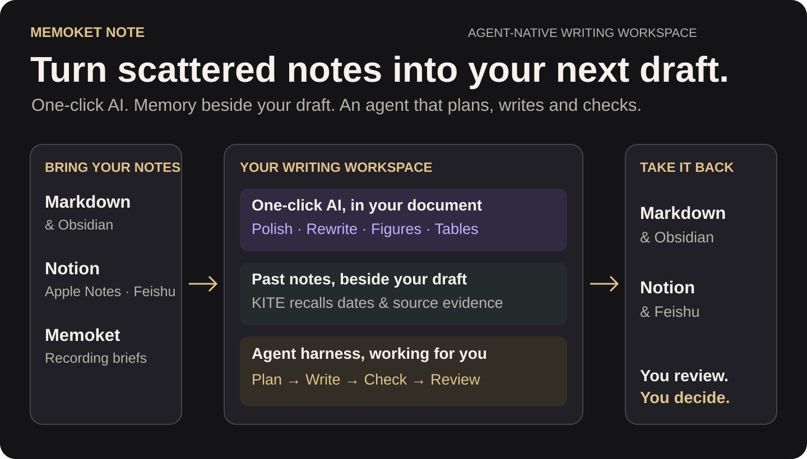
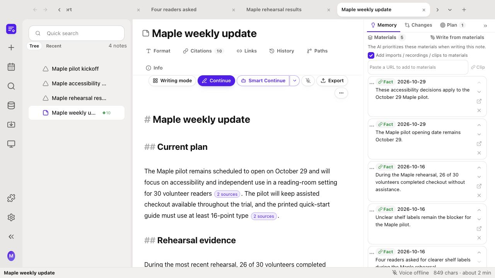
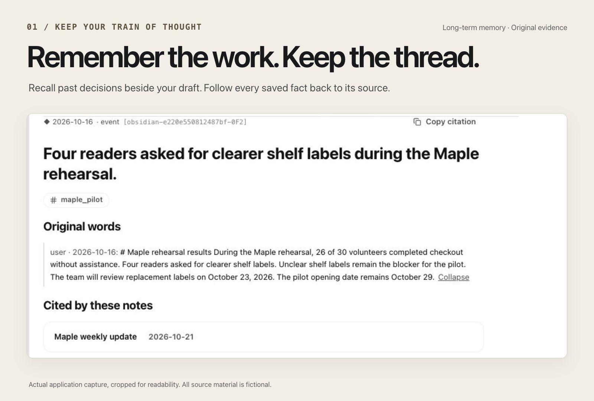
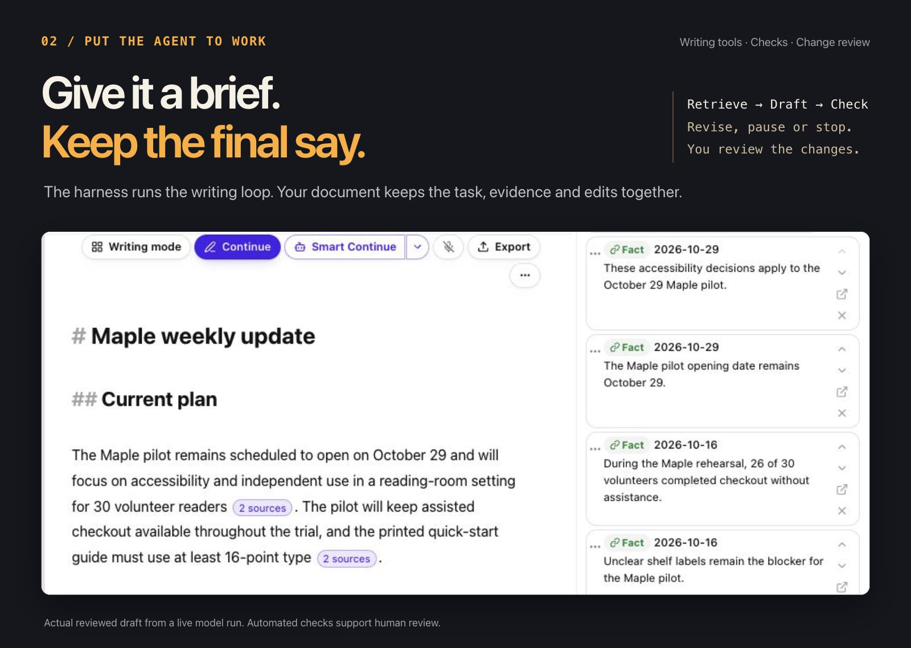
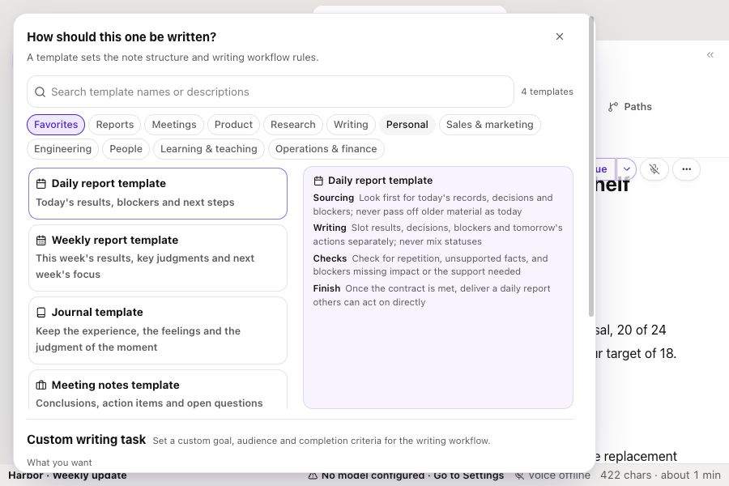
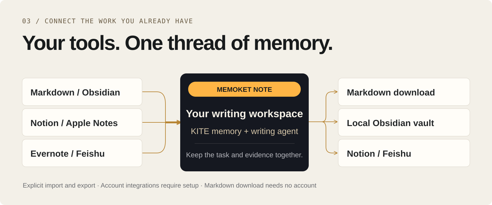
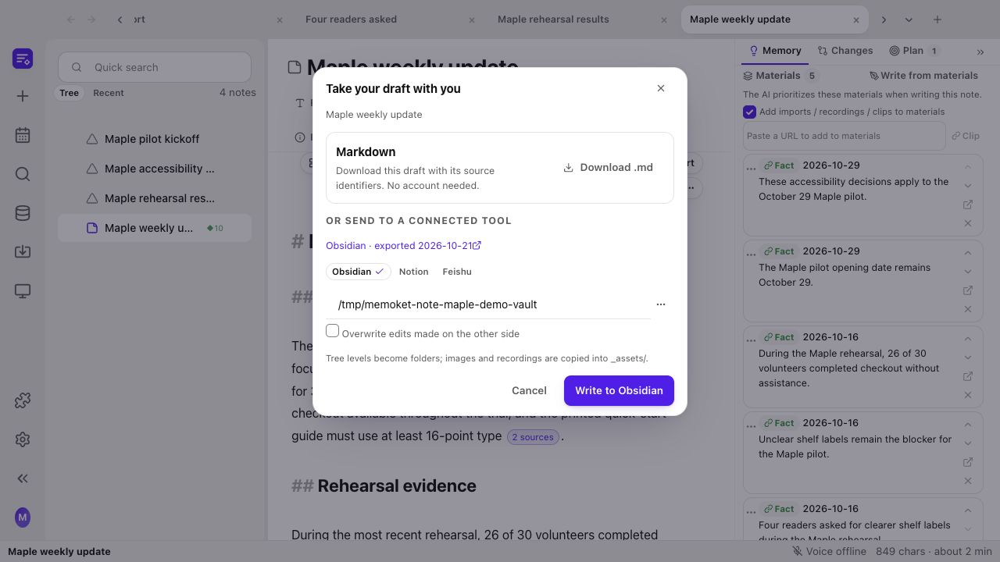

<p align="center">
  <picture>
    <source media="(max-width: 600px)" srcset="docs/media/readme/workflow-mobile.svg">
    
  </picture>
</p>

<p align="center">
  <a href="#see-the-workflow"></a>
&nbsp;
  <a href="#development-setup"></a>
&nbsp;
  <a href="https://github.com/memoket/memoket-kite"></a>
</p>

<p align="center">
  <strong>Write and revise with an agent that recalls your notes and source evidence.</strong><br>
Keep your knowledge locally, choose your model, and review changes inside the document.<br>
Built on <a href="https://github.com/memoket/memoket-kite">Memoket KITE</a>.
</p>

<p align="center">
  <a href="https://github.com/bigsisterPengpeng/Memoket-note"></a>
</p>

<p align="center">
  <a href="#why-agent-native">Why agent-native?</a> &nbsp; / &nbsp;
  <a href="#memory-without-the-detour">Memory</a> &nbsp; / &nbsp;
  <a href="#a-task-a-harness-a-result-you-can-review">The harness</a> &nbsp; / &nbsp;
  <a href="#bring-your-notes-keep-your-workflow">Connections</a> &nbsp; / &nbsp;
  <a href="#future-work">Future work</a> &nbsp; / &nbsp;
  <a href="CONTRIBUTING.md">Contribute</a>
</p>

## Why agent-native?

**You opened a document. Why are you managing a chat?**

Copy a paragraph into a chatbot. Explain the context. Paste the answer back. Find an old note, switch to the browser, then try to remember where you were going. Ask for one more revision and lose the part you wanted to keep.

NOTE is designed around three goals:

- **One action, one button.** Polish, Rewrite and Continue work on the passage or document you're in. The workspace supplies context, so common actions do not require a chat round-trip.
- **Memory without leaving the editor.** Recall current and past notes beside the draft. Open dated evidence where you are writing, without reconstructing the background in a separate conversation.
- **A harness that plans and executes.** Set a goal and done criteria. The writing harness uses task or outline planning, retrieves evidence, writes, checks and revises within limits. Review the changes, pause a run or recover earlier work.

That is what *agent-native* means here: the document carries the work; the agent has tools to act on it. Read the [design principles](docs/why-agent-native.md).

## See the workflow

[](docs/media/agent-native-writing-workspace.mp4?raw=1)

**[Watch the video (2 min)](docs/media/agent-native-writing-workspace.mp4?raw=1).** See saved knowledge survive a restart, inform a writing task and open as original evidence for review. The demo also shows inline edits, chart creation and export, using fictional Maple project notes and live model output.

[Download the narrated MP4](docs/media/agent-native-writing-workspace.mp4?raw=1) · [English captions](docs/media/agent-native-writing-workspace.en.vtt) · [Transcript and recording notes](docs/media/agent-native-writing-workspace.md) · [Repeat the example](docs/workspace-tour.md)

Click the static preview to open or download the MP4; the video loads when you choose to watch. Model waits are shortened and frames are sampled. All materials are fictional. English narration is synthetic. Human review is part of the workflow.

### Small edit or complete writing task?

| What you want | Where to act | What happens |
|---|---|---|
| Improve a passage | Select text → right-click **Polish** or **Rewrite** | Edit in context; accept or revert the marked changes |
| Add a figure, table or chart | Type **/** at a line start, or right-click without a selection | **Smart figure**, **Smart table**, **Data visualization** and other inline actions work inside the note |
| Write the next passage | **Continue** | One retrieval-and-writing action at the cursor |
| Work toward a writing goal | **Smart Continue** | Multiple writing/checking rounds, with an outline, stopping limits and optional review after each round |

Smart figure chooses a data chart or generated illustration from context; image generation needs a configured image provider. Continue is for the next passage. Smart Continue is for a bounded writing task. Both keep you in the document.

## Memory without the detour



**The relevant past should meet you where you're writing.** Retrieval follows the paragraph at your cursor. Open a fact's dated evidence, quote it into the note, or collect it in the task's Materials. KITE keeps that memory locally across notes and sessions; it is available beyond the current model conversation.

Browse facts, source records, entities and a timeline in the knowledge base. Memory preserves evidence, not a guarantee that a claim is still current or correct. [Inspect the original screenshot](docs/media/screenshots/source-evidence.png).

## A task, a harness, a result you can review



**Give it a goal, an audience and done criteria.** A direct Continue action handles a small passage. Smart Continue runs an iterative writing workflow with retrieval, generation, checks and a decision to revise, pause or stop. You can pause after each round, inspect edits and recover earlier work.

The editor also supports revision layers, snapshots and history. A later attempt can be worse: the harness can retain an earlier best round, and the interface supports individual edit decisions. Automated checks support your review; they do not prove factual accuracy.

<details>
<summary><strong>What the writing agent harness does</strong></summary>

The **workspace** is the application, **KITE** is its memory engine, and the **writing agent harness** coordinates task state, tools, rounds, quality feedback, stopping conditions and recovery.

**Prepare evidence → draft or revise → check → decide → review.**

The run uses a bounded scope: a passage, block, note or multi-note plan. Retrieved memory and selected Materials feed both generation and scoring. Supported modes also cover chart, table and analysis blocks. Task and outline planning are separate from retrieval planning. Interactive writing retrieves deterministically; the explicit knowledge question path can also plan retrieval with a model. Available planning and checks depend on the selected mode. See [architecture and implementation](docs/architecture.md).

</details>

<details>
<summary><strong>104 templates, plus custom writing tasks</strong></summary>

Templates across 12 categories define sourcing, writing, checking and finish rules. A weekly report and a technical design document need different evidence and completion criteria. A custom task can set the goal for one note.



</details>

## Bring your notes. Keep your workflow.

<picture>
  <source media="(max-width: 600px)" srcset="docs/media/readme/connections-mobile.svg">
  
</picture>

**You should not need to abandon your existing notes to write with their memory.** Bring material in, work from its evidence, then download Markdown or send the reviewed draft to a supported destination. Markdown download needs no account.

<details>
<summary><strong>Import and export compatibility</strong></summary>

| Your existing tool or material| Bring it into NOTE | Take work out of NOTE |
|---|---|---|
| Markdown / Obsidian | Import Markdown files or a vault; retain the folder structure and clean app-specific syntax | Export Markdown or write into a local vault |
| Notion | Import pages accessible to your integration | Write notes as child pages under a selected parent |
| Feishu | Import supported documents, Drive or Wiki content available to your app | Write documents into a selected folder |
| Evernote | Import exported `.enex` notebooks | Export the resulting notes as Markdown |
| Apple Notes on macOS | Import through the local Notes app | Export Markdown for further use |
| PDF, DOCX and plain text | Batch import source documents into the knowledge base | Use the recalled evidence in your drafts |
| Memoket hardware companion | Search recordings through the official CLI; import selected brief snapshots into notes and optional KITE extraction | Export the resulting draft through NOTE; no write-back to the companion |
| Recordings | Transcribe with a configured local or hosted service, then import | Work from the transcript and extracted knowledge |
| A web page | Clip its text into the current note's Materials | Use the selected material during writing |



</details>

Notion and Feishu adapters need real-account end-to-end validation. Apple Notes import uses the local macOS Notes app. Connections are explicit imports and exports; universal live synchronization and editor extensions are not included. [Connection setup and limits](docs/connections.md).

## Open to your agents. Connected to Memoket.

**Your recorder can supply the source. Your agent can work in the workspace.** Import selected recording briefs from the Memoket hardware companion through its official CLI. NOTE's own CLI and stdio MCP let external agents read notes, recall KITE memory, create drafts and propose revisions.

```sh
# With the local backend running, from backend/
.venv/bin/python -m app.cli recall "Maple shelf labels"
.venv/bin/python -m app.cli memoket-read search_recordings --json '{"query":"Maple"}'
```

[Set up NOTE CLI/MCP and the Memoket connection](docs/agents-and-memoket.md). Companion access uses your existing official CLI login. Real-account import still needs validation; the demo uses fictional notes rather than private recordings.

## Development setup

Use Python 3.11 and Node.js 22.12 or later. The browser edition needs a current browser, including Safari 17.4 or later. From the repository root:

```sh
python3 -m venv backend/.venv
backend/.venv/bin/python -m pip install --upgrade pip setuptools -c backend/constraints.txt
backend/.venv/bin/python -m pip install -r backend/requirements.txt -r backend/requirements-dev.txt -c backend/constraints.txt
cp .env.example backend/.env
```

Start the backend:

```sh
cd backend
.venv/bin/python -m uvicorn app.main:app --reload --host 127.0.0.1 --port 8000
```

In another terminal, start the frontend:

```sh
cd frontend
npm ci
npm run dev
```

Open `http://localhost:5173`. Vite proxies `/api` to the backend. The API reference is at `http://127.0.0.1:8000/docs`; `/api/health` reports backend and service status.

In Settings, select a writing provider and model. Hosted providers need your own credentials. Local providers need a running OpenAI-compatible server. Environment variables provide deployment defaults; settings saved in the application take precedence. An optional judge model can be configured separately.

<details>
<summary><strong>Desktop development and packaging</strong></summary>

Keep the Vite development server running, then start Electron:

```sh
cd desktop
npm ci
npm run dev
```

To package, install PyInstaller in the backend virtual environment, then build:

```sh
backend/.venv/bin/python -m pip install pyinstaller -c backend/constraints.txt
cd desktop
npm run dist
```

Packages are written to `desktop/out/`. Signing credentials are specific to the maintainer's environment; contributors can override electron-builder signing configuration for their own builds. A package includes the backend and frontend. User data is stored outside the application bundle.

</details>

<details>
<summary><strong>Architecture and implementation</strong></summary>

A React and CodeMirror editor runs over a FastAPI backend, with KITE for local memory and an Electron desktop shell. The [architecture guide](docs/architecture.md) explains the modules, writing tools and harness loop. The running backend exposes request schemas at `/docs`.

Interactive writing paths use deterministic retrieval. Model-based planning is available on the explicit knowledge question path. Writing workflows share a loop and express their differences through mode configuration and checks.

Design references: [architecture](docs/architecture.md), [UI conventions](docs/UI_SPEC.md), and [shared cases](shared/README.md).

</details>

<details>
<summary><strong>Validation and test commands</strong></summary>

See [validation notes](docs/validation.md) for results, platforms and remaining manual checks. Automatic CI is not enabled in this initial publication; a [GitHub Actions workflow template](docs/ci-workflow.yml.example) is included.

```sh
cd backend
PYTHONPATH=. .venv/bin/python -m pytest -q

cd ../frontend
npm test
npm run build

cd ../desktop
npm run build
```

Automated tests use stubs instead of live model calls. The separately recorded Maple workflow uses a real configured model. Frontend test commands give backend subprocesses disposable data directories. Backend fixtures isolate database writes. The source distribution excludes private corpora, archived research evidence and screenshot-driving scripts. Test results are not live-model quality benchmarks.

Frontend checks cover types, lint, component/editor behavior and shared frontend/backend contracts. The source-language audit rejects literal Han characters outside the dedicated optional translation dictionaries. Model instructions and default UI text are English; multilingual document content remains supported.

See [CONTRIBUTING.md](CONTRIBUTING.md) for change conventions and [SECURITY.md](SECURITY.md) for deployment and reporting guidance.

</details>

## Future work

Areas for further development:

- [ ] **Easier local setup.** Guided model configuration, simpler launch commands and packaged releases for Windows and Linux.
- [ ] **Validated account connections.** Test Notion, Feishu, Apple Notes and Memoket workflows against real accounts, with clear platform support and setup guides.
- [ ] **Writing and memory evaluations.** Expand repeatable tasks that measure retrieval relevance, citation correctness and the quality of multi-round revisions.
- [ ] **Richer document workflows.** Develop research, data analysis and presentation workflows beyond the current Markdown slides and PDF export.
- [ ] **Release automation and platform checks.** Enable CI and expand validation of native dark mode, accessibility and platform-specific behavior.

Have a writing workflow you want supported? [Open an issue](https://github.com/bigsisterPengpeng/Memoket-note/issues) or [contribute](CONTRIBUTING.md).

**Want to see what comes next? [Give us a star.](https://github.com/bigsisterPengpeng/Memoket-note)**

## Built on KITE. Made as a personal project.

[Memoket KITE](https://github.com/memoket/memoket-kite) is the separate open-source memory engine. It stores structured facts with source evidence and supports inspectable retrieval without an embedding or vector-database stack. NOTE adds the editor, task Materials, writing harness and change-review interface around it.

This is a personal project based on KITE, not a promise of commercial product support. The Memoket name and artwork acknowledge its origins at [memoket.ai](https://memoket.ai). Local KITE memory needs no wearable or Memoket subscription. The optional companion import uses your Memoket account; automatic synchronization with the companion is not included. KITE is independently licensed under Apache-2.0.

### Data and current scope

Notes and settings are stored locally. AI features send relevant content to your configured model or transcription service. Local endpoints can keep processing on your machine or trusted network; hosted services use your accounts and may incur charges. The default interface and prompts are English.

This is an early project for a trusted local environment. Account integrations still need validation. Slide export covers Markdown slides and PDF. See [SECURITY.md](SECURITY.md) for data flow and deployment limits.

### License

Application code: [AGPL-3.0-only](LICENSE). Memory engine: Apache-2.0. [Third-party notices](docs/third-party-notices.md) cover attribution and artwork. Model weights are not included; provider terms apply separately.

<p align="center">
  <a href="https://memoket.ai">Memoket</a> &nbsp; · &nbsp;
  <a href="https://github.com/memoket/memoket-kite">KITE</a> &nbsp; · &nbsp;
  <a href="docs/why-agent-native.md">Design principles</a> &nbsp; · &nbsp;
  <a href="CONTRIBUTING.md">Contributing</a> &nbsp; · &nbsp;
  <a href="SECURITY.md">Security</a>
</p>
